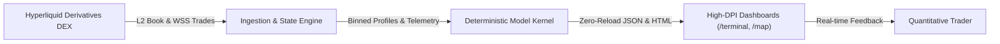
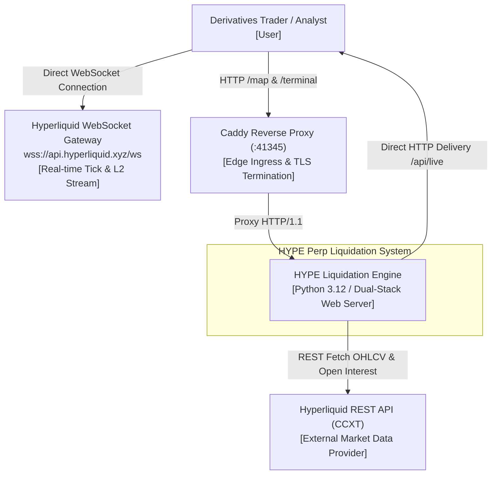
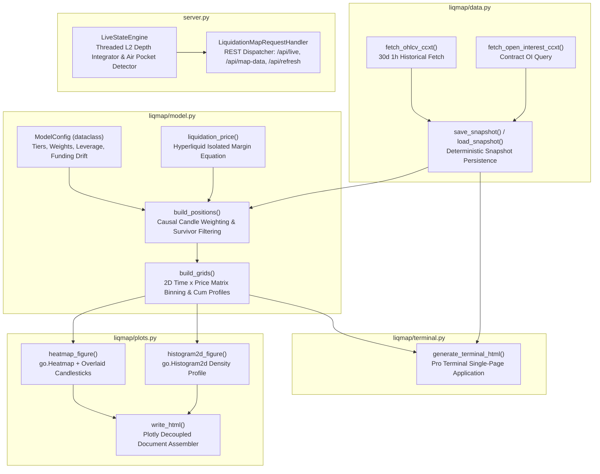
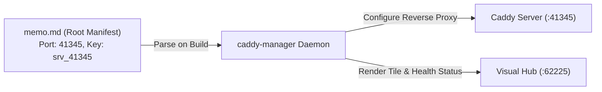

# HYPE Perp Liquidation Map & Terminal
## System Architecture & C4 Engineering Specification

---

### Table of Contents
1. [Architectural Overview](#1-architectural-overview)
2. [C4 Level 1: System Context Diagram](#2-c4-level-1-system-context-diagram)
3. [C4 Level 2: Container Diagram](#3-c4-level-2-container-diagram)
4. [C4 Level 3: Component Diagram](#4-c4-level-3-component-diagram)
5. [C4 Level 4: Code & Model Specifications](#5-c4-level-4-code--model-specifications)
6. [Deployment Topology & Networking](#6-deployment-topology--networking)
7. [Concurrency, Threading & State Synchronization](#7-concurrency-threading--state-synchronization)

---

### 1. Architectural Overview

The **HYPE Perp Liquidation Engine** is structured as a decoupled, multi-tier quantitative system. It bridges high-throughput asynchronous market feeds (Hyperliquid WebSocket) with deterministic batch modeling (CCXT historical data) and renders high-density browser dashboards (HTML5 Canvas + Plotly.js).



The system is organized into four distinct architectural layers:
1. **Exchange Interface Layer:** Ingests live orderbook snapshots and tick streams via CCXT REST and Hyperliquid WebSocket.
2. **Deterministic Modeling Layer:** Computes discrete position matrices, applies age decay, solves isolated-margin liquidation equations, and scales survivors to total open interest.
3. **Application & Telemetry Layer:** Provides high-concurrency state caching, REST API dispatching, dual-stack HTTP serving, and automated test execution.
4. **Presentation & Simulation Layer:** Delivers low-latency browser visualizations with GPU-accelerated canvas charts, DOM recycling, and reactive Plotly graph patching.

---

### 2. C4 Level 1: System Context Diagram

The System Context diagram details how external actors and exchange services interface with the HYPE Perp Liquidation platform.



---

### 3. C4 Level 2: Container Diagram

The Container diagram illustrates the execution environment, process boundaries, and protocols connecting system processes.

```mermaid
flowchart TB
    subgraph Host ["Local Host / Server (Windows / WSL2 / Linux)"]
        subgraph IngressLayer ["Ingress & Reverse Proxy"]
            CaddyProxy["Caddy Web Server<br/>Port 41345<br/>[Reverse Proxy & Static Asset Caching]"]
        end

        subgraph ContainerEnv ["Podman / Python Runtime (n1-liqmap-container)"]
            HTTPServer["DualStackServer (server.py)<br/>Port 12312<br/>[ThreadingHTTPServer IPv4/IPv6]"]
            StateEngine["LiveStateEngine (server.py)<br/>[In-Memory Thread-Safe State & Orderbook Cache]"]
            BatchPipeline["CLI Batch Engine (liqmap/cli.py)<br/>[Historical Ingestion & Model Pipeline]"]
            StaticAssets["Disk Storage (/output)<br/>[HTML, CSV, JSON, Plotly.min.js]"]
        end
    end

    subgraph ClientBrowser ["Trader Browser Client"]
        TerminalUI["Pro Terminal Dashboard<br/>(/terminal)<br/>[HTML5 Canvas + Fire Tape HUD]"]
        MapUI["Liquidation Map Dashboard<br/>(/map)<br/>[Plotly.js + Shock Simulator]"]
    end

    subgraph RemoteExchange ["Hyperliquid Exchange Infrastructure"]
        HL_API["CCXT Hyperliquid API"]
        HL_WSS["Hyperliquid Public WebSocket"]
    end

    CaddyProxy -->|Proxy Pass :12312| HTTPServer
    HTTPServer -->|Serve Static Files| StaticAssets
    HTTPServer -->|Read Cached Telemetry| StateEngine
    StateEngine -->|Poll L2 Depth (2s)| HL_API
    BatchPipeline -->|Fetch 30d OHLCV & OI| HL_API
    BatchPipeline -->|Write Processed Assets| StaticAssets
    TerminalUI -->|Subscribe trades, allMids| HL_WSS
    TerminalUI -->|Poll /api/live (2.5s)| CaddyProxy
    MapUI -->|Fetch /api/map-data| CaddyProxy
    MapUI -->|Load Script| StaticAssets
```

---

### 4. C4 Level 3: Component Diagram

The Component diagram unpacks the internal Python packages and frontend browser modules.



---

### 5. C4 Level 4: Code & Model Specifications

#### Algorithmic Invariants
- **Zero Lookahead:** During survivor filtering, position $j$ created at candle $i$ is evaluated strictly against future market candles $k > i$:
  $$\text{Long hit if } \min_{k \in [i+1, N-1]} \text{low}_k \le P_{\text{liq}}$$
  $$\text{Short hit if } \max_{k \in [i+1, N-1]} \text{high}_k \ge P_{\text{liq}}$$
  This is implemented using vectorized NumPy cumulative extrema:
  ```python
  fut_low = np.minimum.accumulate(low[i + 1:])
  j = np.searchsorted(-fut_low, -liq_price, side="left")
  ```
  Time complexity for $N$ candles, $K$ tiers, and $S$ entry samples is $O(N \cdot K \cdot S \cdot \log N)$, running in $<0.3\text{ seconds}$ for 720 candles.

- **Monotonic Profile Accumulation:**
  Cumulative shorts strictly increase as price rises above spot:
  $$C_{\text{short}}(P_a) \le C_{\text{short}}(P_b) \quad \forall \; P_a \le P_b \quad (P \ge P_{\text{ref}})$$
  Cumulative longs strictly increase as price falls below spot:
  $$C_{\text{long}}(P_a) \ge C_{\text{long}}(P_b) \quad \forall \; P_a \le P_b \quad (P \le P_{\text{ref}})$$

- **End-to-End Pipeline Verification:**
  Data pipeline contracts, exchange interfaces, and state lifecycles are formally enforced by 56 automated tests across 7 test suites, including dedicated end-to-end dataflow validation in [`tests/test_e2e_dataflow.py`](file:///D:/projects/N1/tests/test_e2e_dataflow.py) and browser testing in [`tests/test_e2e_playwright.py`](file:///D:/projects/N1/tests/test_e2e_playwright.py).


---

### 6. Deployment Topology & Networking

The system operates under three concurrent deployment configurations:

| Deployment Type | Orchestrator | Port Mapping | Storage |
|:---|:---:|:---:|:---|
| **Local Native** | Python 3.12 | `0.0.0.0:12312` | Local filesystem `D:\projects\N1` |
| **Container Daemon** | Podman (WSL2) | Host networking (`--net=host`) | Shared volume `/mnt/d/projects/N1:/app:z` |
| **Reverse Proxy** | Caddy Server | `:41345` $\to$ `localhost:12312` | Memory-mapped reverse proxy cache |

```
[External / LAN Client]
         |
         v
 [Caddy Gateway :41345]  (Reverse Proxy, Compression, Gzip)
         |
         v
 [DualStackServer :12312] (ThreadingHTTPServer, IPv4/IPv6)
         |
         +--> /terminal.html (Pro Terminal Dashboard)
         +--> /hype_liquidation_map.html (Plotly Map)
         +--> /plotly.min.js (4.8MB Decoupled Bundle)
         +--> /api/live (Telemetry JSON)
         +--> /api/map-data (Zero-reload JSON matrix)
         +--> /api/refresh (Trigger pipeline rebuild)
```

---

### 7. Concurrency, Threading & State Synchronization

1. **`LiveStateEngine` Concurrency Model:**
   - Operates a dedicated background daemon thread polling CCXT L2 orderbook depth every 2.0 seconds.
   - Guarded by a mutual exclusion lock (`threading.Lock()`).
   - `get_state()` creates an instantaneous shallow copy of the state dictionary, guaranteeing that HTTP worker threads never block or experience partial writes.

2. **Dual-Stack Socket Management:**
   - Inherits from `http.server.ThreadingHTTPServer` with `daemon_threads = True` and `allow_reuse_address = True`.
   - Binds to IPv6 `::` with transparent fallback to IPv4 `0.0.0.0`, enabling simultaneous access across localhost, intranet, and IPv6 network bridges.

---

### 8. Caddy Manager & Metadata Manifest (`memo.md`)

The deployment architecture integrates with the Antigravity `caddy-manager` daemon and visual hub at `http://localhost:62225`.



- **Manifest Contract:** [`memo.md`](file:///D:/projects/N1/memo.md) defines project slug, display name, target port (`41345`), upstream daemon (`127.0.0.1:12312`), and last build timestamp.
- **Visual Inspection:** The visual hub (:62225) continuously monitors Caddy reverse proxy latency and upstream server health.

