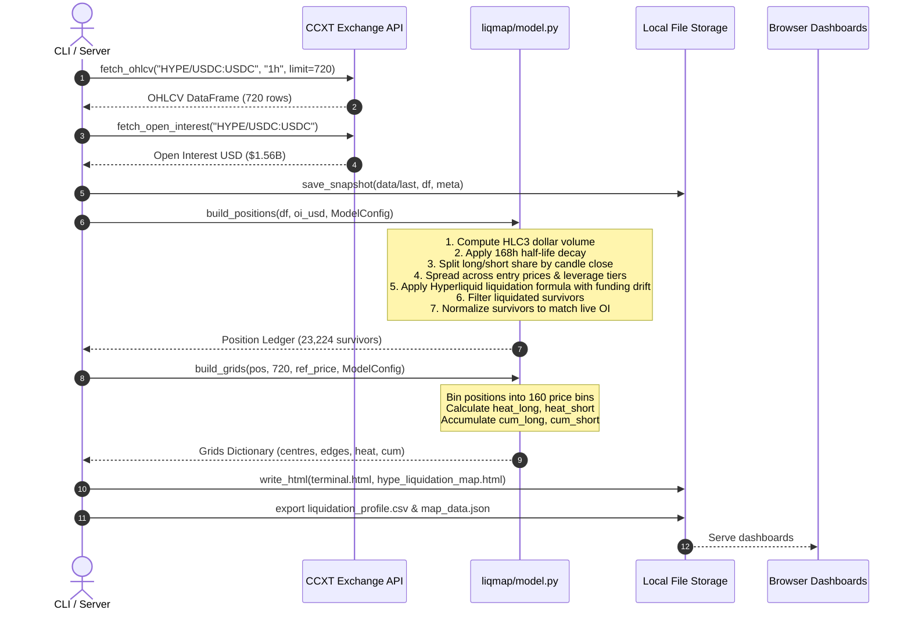
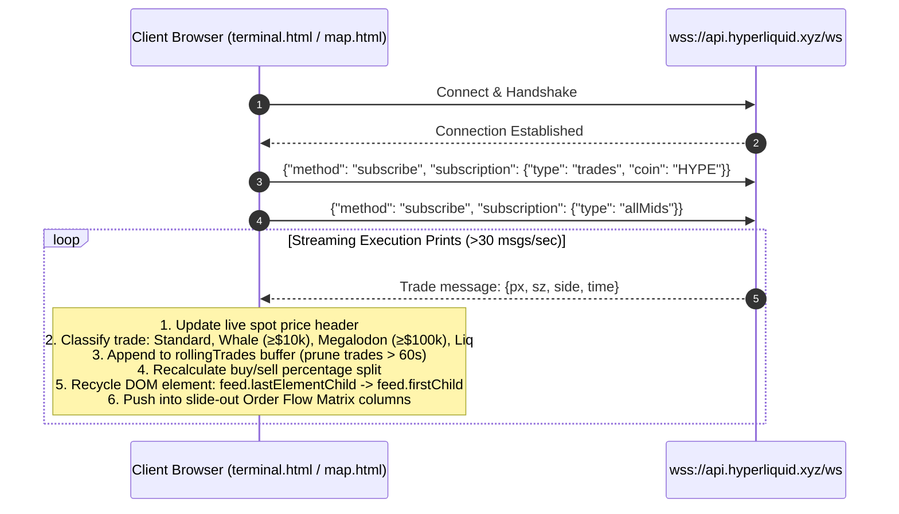
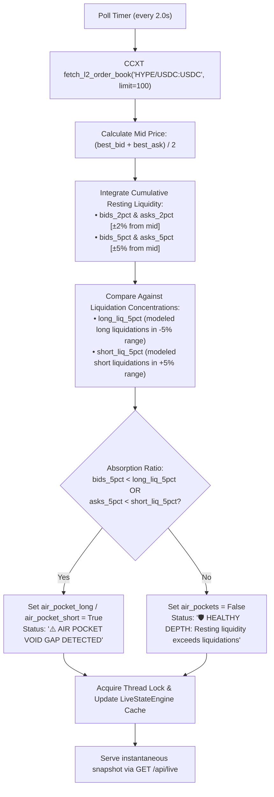
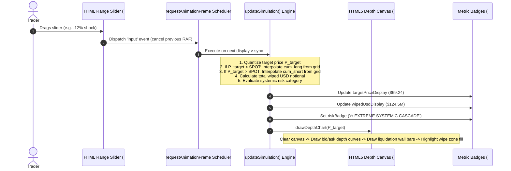
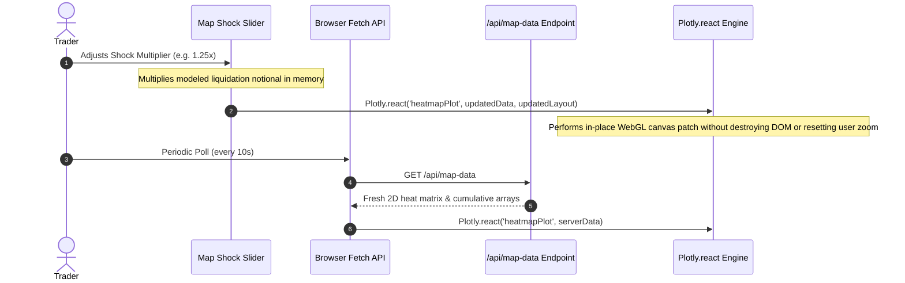
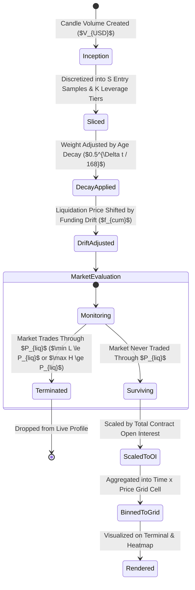
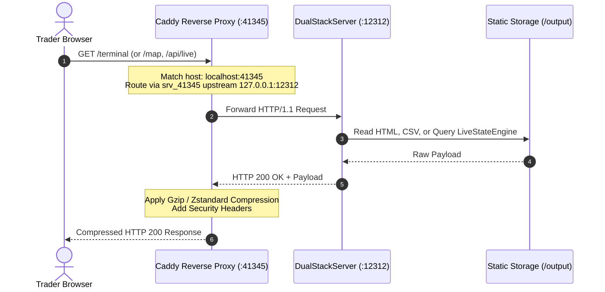

# HYPE Perp Liquidation Map & Terminal
## End-to-End Data Flow & State Lifecycle Specification

---

### Table of Contents
1. [Data Pipeline Architecture](#1-data-pipeline-architecture)
2. [Pipeline 1: Batch Historical Ingestion & Deterministic Model](#2-pipeline-1-batch-historical-ingestion--deterministic-model)
3. [Pipeline 2: Real-time Hyperliquid WebSocket Tick Processing](#3-pipeline-2-real-time-hyperliquid-websocket-tick-processing)
4. [Pipeline 3: L2 Orderbook Depth & Air Pocket Detection](#4-pipeline-3-l2-orderbook-depth--air-pocket-detection)
5. [Pipeline 4: Client-side Interactive Waterfall & Shock Simulation](#5-pipeline-4-client-side-interactive-waterfall--shock-simulation)
6. [Pipeline 5: Zero-Reload Map Recalculation Flow](#6-pipeline-5-zero-reload-map-recalculation-flow)
7. [State Lifecycle Machine](#7-state-lifecycle-machine)

---

### 1. Data Pipeline Architecture

The system coordinates three asynchronous data rhythms:
1. **Low-Frequency Macro Flow (Hourly/On-demand):** 30-day OHLCV ingestion, position modeling, and grid generation ($N=720$ candles).
2. **Medium-Frequency Telemetry Flow (Every 2–2.5 Seconds):** Orderbook L2 depth aggregation, liquidation absorption ratios, and air pocket classification.
3. **High-Frequency Microstructure Flow (>30 Ticks/Second):** Live Hyperliquid WebSocket execution tape, rolling 60s delta balance, and DOM-recycled trade cards.

```mermaid
flowchart TD
    subgraph DataSources ["External Market Feeds"]
        HL_REST["Hyperliquid REST (CCXT)"]
        HL_WS["Hyperliquid WebSocket Gateway"]
    end

    subgraph BatchFlow ["Batch Historical Pipeline (Pipeline 1)"]
        P1["fetch_ohlcv_ccxt()"] --> P2["build_positions()"]
        P2 --> P3["build_grids()"]
        P3 --> P4["Output Artifacts: HTML, CSV, JSON"]
    end

    subgraph TelemetryFlow ["Live Telemetry & Depth Pipeline (Pipeline 3)"]
        T1["fetch_l2_order_book()"] --> T2["Integrate 2% & 5% Liquidity"]
        T2 --> T3["Evaluate Air Pocket Invariants"]
        T3 --> T4["Publish /api/live State"]
    end

    subgraph TickFlow ["Real-time Microstructure Pipeline (Pipeline 2)"]
        W1["wss://api.hyperliquid.xyz/ws"] --> W2["DOM-Recycled Fire Tape HUD"]
        W2 --> W3["Rolling 60s Volume Delta Bar"]
        W3 --> W4["Order Flow Matrix Columns"]
    end

    HL_REST --> BatchFlow
    HL_REST --> TelemetryFlow
    HL_WS --> TickFlow
```

---

### 2. Pipeline 1: Batch Historical Ingestion & Deterministic Model

This pipeline transforms raw OHLCV market history into the deterministic liquidation ledger.

---

### 3. Pipeline 2: Real-time Hyperliquid WebSocket Tick Processing

Direct browser connection streaming live executions directly from Hyperliquid without server proxy overhead.

---

### 4. Pipeline 3: L2 Orderbook Depth & Air Pocket Detection

Background integration assessing market robustness and liquidation cascade vulnerability.

---

### 5. Pipeline 4: Client-side Interactive Waterfall & Shock Simulation

GPU-accelerated interactive cascade simulation on [`output/terminal.html`](file:///D:/projects/N1/output/terminal.html).

---

### 6. Pipeline 5: Zero-Reload Map Recalculation Flow

Reactive update cycle on [`output/hype_liquidation_map.html`](file:///D:/projects/N1/output/hype_liquidation_map.html).

---

### 7. State Lifecycle Machine

The operational lifecycle of a position bucket within the quantitative model.

---

### 8. Pipeline 6: Caddy Edge Ingress & Reverse Proxy Routing Flow

The ingress path connecting external browser clients to internal application processes.

---

### 9. End-to-End Pipeline Verification Matrix

Each pipeline is formally verified by automated tests in [`tests/test_e2e_dataflow.py`](file:///D:/projects/N1/tests/test_e2e_dataflow.py):

| Pipeline | Test Class & Method | Invariant Assertions |
|:---|:---|:---|
| **Pipeline 1** | `TestPipeline1HistoricalBatch.test_pipeline_1_deterministic_flow` | Bit-for-bit reproducibility, zero-lookahead survivor integrity, exact Open Interest conservation ($L_{\text{alive}} = \text{OI}$, $S_{\text{alive}} = \text{OI}$), cumulative monotonicity |
| **Pipeline 2** | `TestPipeline2WebSocketTickProcessing.test_hyperliquid_live_wss_stream` `TestPipeline2WebSocketTickProcessing.test_trade_classification_and_rolling_delta_logic` | Live `wss://api.hyperliquid.xyz/ws` connection, `allMids` & `trades` frames, rolling 60s delta accumulation, standard/whale/megalodon classification |
| **Pipeline 3** | `TestPipeline3DepthAndAirPocket.test_live_depth_aggregation_and_air_pocket_contract` | Schema contract, $5\% \ge 2\%$ liquidity ordering, absorption ratio calculation, air pocket boolean flag consistency |
| **Pipeline 4** | `TestPipeline4WaterfallShockSimulation.test_waterfall_simulator_e2e_dataflow` | Interactive slider shock interaction, rAF debouncer, wiped USD tally, depth canvas redraw, risk badge state transition |
| **Pipeline 5** | `TestPipeline5ZeroReloadMapRecalculation.test_map_data_endpoint_contract` `TestPipeline5ZeroReloadMapRecalculation.test_plotly_react_shock_tester_e2e` | `/api/map-data` schema validation, zero-reload `Plotly.react` WebGL canvas patch without document reload |
| **Pipeline 6** | `TestPipeline6CaddyIngressAndProxy.test_caddy_reverse_proxy_endpoints` `TestPipeline6CaddyIngressAndProxy.test_deployment_memo_manifest_integrity` | Edge port `:41345` reverse proxy to `:12312`, gzip compression header verification, [`memo.md`](file:///D:/projects/N1/memo.md) manifest schema integrity |

